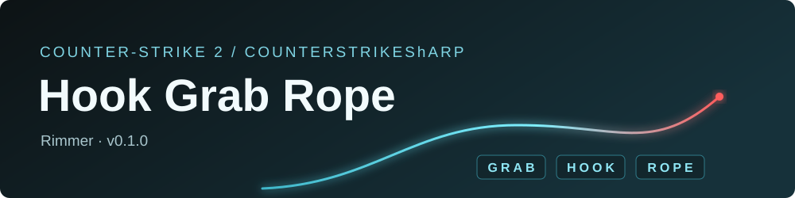

# HookGrabRope

[](https://boosty.to/rimmerquinella)



[English](#english) · [Русский](#русский)

## English

**Hook Grab Rope 0.1.0** by **Rimmer** brings the SourceMod classic *Hook Grab Rope 1.1.4* by Sheepdude and SumGuy14 to CS2. Hook pulls you to a wall, Grab drags a player or a dropped weapon behind your crosshair and throws it with G, Rope lets you swing on a fixed point. Grab follows Muinez's *garrys mod like grab*: the target is pulled to a point in front of your eyes and the beam bends while it catches up.

### Requirements

- CS2 dedicated server with [CounterStrikeSharp](https://github.com/roflmuffin/CounterStrikeSharp) **1.0.380** (.NET 10). Linux x64 is the tested platform; on Windows G is handled through the `drop` command, because the gamedata signature is Linux-only for now.
- A client addon for the Laser, Lasso and Chain lines and for the sounds. The Beam line uses the stock `materials/sprites/laserbeam.vmat` and needs nothing extra. See [Client addon](#client-addon).
- Optional: [PMM_SimpleAdmin](https://github.com/RRimmer/PMM_SimpleAdmin) **0.1.1** for the `!admin → Manage HGR` section, [VIPCore](https://github.com/partiusfabaa/cs2-VIPCore) **2.0.3** with [PMM_VIPCore](https://github.com/RRimmer/PMM_VIPCore_partiusfabaa) **0.1.6** for the `!vip → HGR` card and toasts.

### Abilities

| Ability | How it plays |
| --- | --- |
| **Grab** | One attempt per press. Grabs a living player or a dropped weapon within `Range` (550 units by default); a miss costs no charge. The target is held `Start.Distance` in front of you and follows the crosshair along an 11-segment curved beam. The wheel moves it farther or closer, G throws it with `Strength`. The victim sees who grabbed them and hears the looped lasso sound. |
| **Hook** | Attaches to the world point under the crosshair. With `Pull = true` you are pulled to the endpoint and held there; with `Pull = "Self"` the wheel reels the rope by hand. Releasing the key or pressing again detaches. |
| **Rope** | Fixes a rope at the hit point and limits how far you can move away from it, keeping your sideways speed so you can swing. With `Pull = true` the wheel changes the rope length. |

All three draw a line of the selected type — `Beam`, `Laser`, `Lasso` or `Chain` — in a palette colour, `rainbow`, or the team colour.

### Access and limits

- **Admin profile** — `Admin.Enabled` plus `Admin.Flag` (`@css/root` by default).
- **VIP profile** — the `HGR` object inside a VIPCore group's `Values`. Each field is a fixed number, a range such as `"1-3"`, `"default"` or `false`; `false` locks the field to the server default.
- `Amount` is the number of successful uses per round, `-1` is unlimited. Misses and failed hooks do not spend a charge.
- With both roles the player picks the profile through `Settings.Priority`, and personal values are stored per SteamID next to the DLL in `preferences.json` and `vip-preferences.json`.

### Commands

| Command | Purpose |
| --- | --- |
| `css_grab`, `css_hook`, `css_rope` | Toggle the ability. With `Sticking = false` the command prints the hold bind instead of starting. |
| `css_<ability>_on`, `css_<ability>_off` | Start and stop for a hold bind. |
| `css_<ability>_farther`, `css_<ability>_closer` | Wheel steps. Grab moves the target, Hook and Rope change the rope length. |
| `css_hgr_admin`, `css_hgr_vip` | Open the admin or VIP panel. |
| `css_hgr_reload` | Reload `hgr.jsonc`, end active abilities and close the panels. Server console or an admin. |
| `css_hgr_visual beam\|laser\|lasso\|chain\|default` | Server console only: force the Grab line for comparison. `default` returns to each player's choice. |

### Configuration

`addons/counterstrikesharp/configs/plugins/HookGrabRope/hgr.jsonc` is created on first load and contains `Defaults`, `Admin`, `Settings`, `PaletteDef`, `PaletteHex` and `Particles`. A configuration from the old `Everyone`/`Vip` schema is copied to `hgr.old.jsonc` and replaced with the current template.

| `Settings` | Default | Effect |
| --- | --- | --- |
| `Priority` | `Admin` | Which profile wins when a player is both admin and VIP: `Admin` or `Vip`. |
| `Step` | `50` | Menu step for `Distance`, `Start.Distance` and `Strength`. |
| `MaxWidth` | `5` | Upper bound for line width; the menu step is 0.5. |
| `MaxRange` | `8000` | Upper bound for `Range`. |
| `MaxDistance` | `8000` | Upper bound for `Distance`. |
| `MaxStartDistance` | `8000` | Upper bound for `Grab.Start.Distance`. |
| `MaxStrength` | `1000` | Upper bound for the throw force. |
| `MaxStep` | `100` | Upper bound for `Step up` and `Step down`. |
| `Chat` | `true` | Chat notifications by default; players can change it in the panel. |
| `Toast` | `true` | PMM_VIPCore toasts by default. |
| `Sounds` | `true` | Master switch for every sound. |

Each ability block has `Enabled`, `Amount`, `Color`, `EffectLine`, `Width`, `Range`, `Step up`, `Step down`, `Pull`, `Sticking` and a group of `Sound*` paths. Hook also reads `Distance`; Grab reads `Distance`, `Start.Distance` and `Strength`. `Pull` is `true`, `false` or `"Self"`; `Sticking` selects press-to-toggle or hold-to-use.

### Install from a release

1. Install CounterStrikeSharp **1.0.380** on the server.
2. Take `HookGrabRope-CS2.zip` from [Releases](../../releases/latest) and unpack `addons/` into `game/csgo/`. Skip your existing `hgr.jsonc` when updating — the plugin backs up the old schema itself.
3. Copy `Content-addonmanager/` into the sources of your Workshop addon, rebuild it and ship it through MultiAddonManager, then change the map. Without this step Beam still works; Laser, Lasso, Chain and the sounds stay silent.
4. Check `css_plugins list`, tune `hgr.jsonc`, run `css_hgr_reload`.
5. To give the abilities to VIP players, add an `HGR` object to a group in `vip.json`. The full example and the field rules are in [INSTALL.md](INSTALL.md#vipcore-fabius).

### Client addon

`Content-addonmanager/` holds the client side:

| Path | Contents |
| --- | --- |
| `particles/hgr/` | `laser.vpcf`, `lasso.vpcf`, `chain.vpcf` — the three particle lines. |
| `materials/hgr/deadlock/` | Textures used by those particles. |
| `sounds/hgr/` | Seven sound files; `*_lp_loop.wav` carries the loop markers for the held lasso. |
| `soundevents/hgr.vsndevts` | The `HGR.*` sound events the plugin emits. |
| `panorama/` | `hgr_admin.xml`, `hgr_vip.xml` and the shared CSS for the in-game panels. |

`hgr.xml` and `hgr.css` are the legacy preview panel from earlier builds. The plugin opens `hgr_admin.xml` and `hgr_vip.xml`, so the release archive leaves the legacy pair out.

Merge the folder into your addon sources, rebuild, upload and change the map. A new particle or a new `PaletteHex` entry also needs a rebuild of that addon.

### Menus and binds

The panels are Panorama custom HUD layouts: `!admin → Manage HGR` through PMM_SimpleAdmin, `!vip → HGR` through PMM_VIPCore, or `css_hgr_admin` / `css_hgr_vip` directly. Every ability page shows its own bind lines in chat.

```cfg
bind V css_grab
alias +hgr_grab "css_grab_on"
alias -hgr_grab "css_grab_off"
bind mouse4 +hgr_grab
bind mwheelup "invprev; css_grab_farther; css_hook_closer; css_rope_closer"
bind mwheeldown "invnext; css_grab_closer; css_hook_farther; css_rope_farther"
```

Use the toggle bind with `Sticking = true` and the alias pair with `Sticking = false`. The wheel binds keep weapon switching.

### Repository layout

| Path | Contents |
| --- | --- |
| `HookGrabRope/` | Plugin sources, project file and translations. |
| `configs/plugins/HookGrabRope/` | Default `hgr.jsonc`; the same file is embedded into the DLL. |
| `gamedata/` | Linux signature that lets G throw the grabbed target. |
| `Content-addonmanager/` | Client particles, materials, sounds, sound events and Panorama panels. |
| `.github/workflows/` | Build and ZIP packaging on every push. |

### Build

With .NET SDK 10:

```bash
dotnet build HookGrabRope/HookGrabRope.csproj -c Release
```

On Windows `pack.cmd` builds the plugin and writes `HookGrabRope-CS2.zip` with the DLL, `lang`, `gamedata`, `hgr.jsonc`, the client addon files and `addon-resources.json`. The same archive is produced by CI as a workflow artifact.

### Credits

- *Hook Grab Rope 1.1.4* for SourceMod — **Sheepdude** and **SumGuy14**.
- Grab behaviour — **Muinez**, *garrys mod like grab* (`vectorTest.sp`).
- CS2 port, Panorama panels and configuration model — **Rimmer**.

### Assets and license

The plugin source is licensed under the **GNU GPL v3** (see [LICENSE](LICENSE)). Particle textures, sounds and the `hgr.vsndevts` bank are Valve game assets taken from Deadlock and Counter-Strike 2; they are not covered by the GPL and are shipped only to run the addon with the game. The project is not affiliated with Valve.

[Installation guide](INSTALL.md) · [Changelog](CHANGELOG.md) · [License](LICENSE)

---

## Русский

**Hook Grab Rope 0.1.0** от **Rimmer** — перенос классического SourceMod-плагина *Hook Grab Rope 1.1.4* (Sheepdude, SumGuy14) на CS2. Hook подтягивает игрока к стене, Grab тащит игрока или выпавшее оружие за прицелом и бросает его по G, Rope даёт раскачиваться на закреплённой точке. Grab повторяет *garrys mod like grab* от Muinez: цель тянется к точке перед глазами, и луч изгибается, пока она догоняет.

### Что нужно

- Сервер CS2 с [CounterStrikeSharp](https://github.com/roflmuffin/CounterStrikeSharp) **1.0.380** (.NET 10). Проверенная платформа — Linux x64; на Windows бросок по G идёт через команду `drop`, потому что сигнатура в gamedata пока только для Linux.
- Клиентский аддон для линий Laser, Lasso, Chain и для звуков. Линия Beam использует штатный `materials/sprites/laserbeam.vmat` и ничего не требует. Подробности — в разделе [Клиентский аддон](#клиентский-аддон).
- Опционально: [PMM_SimpleAdmin](https://github.com/RRimmer/PMM_SimpleAdmin) **0.1.1** для раздела `!admin → Управление HGR`, [VIPCore](https://github.com/partiusfabaa/cs2-VIPCore) **2.0.3** и [PMM_VIPCore](https://github.com/RRimmer/PMM_VIPCore_partiusfabaa) **0.1.6** для карточки `!vip → HGR` и тостов.

### Способности

| Способность | Как работает |
| --- | --- |
| **Grab** | Одна попытка на нажатие. Захватывает живого игрока или выпавшее оружие в пределах `Range` (по умолчанию 550 юнитов); промах не тратит заряд. Цель удерживается на `Start.Distance` перед игроком и следует за прицелом по изогнутому лучу из 11 сегментов. Колесо отдаляет и приближает цель, G бросает её с силой `Strength`. Жертва видит, кто её схватил, и слышит зацикленный звук лассо. |
| **Hook** | Цепляется за точку под прицелом. При `Pull = true` игрока подтягивает к ней и удерживает; при `Pull = "Self"` колесо вручную меняет длину троса. Повторное нажатие или отпускание клавиши отсоединяет. |
| **Rope** | Закрепляет трос в точке попадания и ограничивает удаление от неё, сохраняя поперечную скорость для раскачивания. При `Pull = true` колесо меняет длину троса. |

Все три рисуют линию выбранного типа — `Beam`, `Laser`, `Lasso` или `Chain` — цветом из палитры, `rainbow` или цветом команды.

### Доступ и лимиты

- **Профиль администратора** — `Admin.Enabled` и `Admin.Flag` (по умолчанию `@css/root`).
- **Профиль VIP** — объект `HGR` в `Values` группы VIPCore. Каждое поле задаётся числом, диапазоном вроде `"1-3"`, значением `"default"` или `false`; `false` фиксирует поле на серверном значении.
- `Amount` — число успешных применений за раунд, `-1` — безлимит. Промахи и неудачные зацепы заряд не тратят.
- Если игрок и админ, и VIP, профиль выбирает `Settings.Priority`, а личные значения хранятся по SteamID рядом с DLL в `preferences.json` и `vip-preferences.json`.

### Команды

| Команда | Назначение |
| --- | --- |
| `css_grab`, `css_hook`, `css_rope` | Переключатель способности. При `Sticking = false` команда выводит бинд удержания вместо запуска. |
| `css_<способность>_on`, `css_<способность>_off` | Запуск и остановка для бинда удержания. |
| `css_<способность>_farther`, `css_<способность>_closer` | Шаги колеса. У Grab двигают цель, у Hook и Rope меняют длину троса. |
| `css_hgr_admin`, `css_hgr_vip` | Открыть админскую или VIP-панель. |
| `css_hgr_reload` | Перечитать `hgr.jsonc`, завершить способности и закрыть панели. Серверная консоль или администратор. |
| `css_hgr_visual beam\|laser\|lasso\|chain\|default` | Только серверная консоль: принудительная линия для Grab. `default` возвращает выбор игрока. |

### Конфиг

`addons/counterstrikesharp/configs/plugins/HookGrabRope/hgr.jsonc` создаётся при первой загрузке и содержит `Defaults`, `Admin`, `Settings`, `PaletteDef`, `PaletteHex` и `Particles`. Конфиг старой схемы `Everyone`/`Vip` сохраняется рядом как `hgr.old.jsonc` и заменяется текущим шаблоном.

| `Settings` | По умолчанию | Действие |
| --- | --- | --- |
| `Priority` | `Admin` | Чей профиль применяется, если игрок и админ, и VIP: `Admin` или `Vip`. |
| `Step` | `50` | Шаг меню для `Distance`, `Start.Distance` и `Strength`. |
| `MaxWidth` | `5` | Предел ширины линии; шаг в меню 0,5. |
| `MaxRange` | `8000` | Предел `Range`. |
| `MaxDistance` | `8000` | Предел `Distance`. |
| `MaxStartDistance` | `8000` | Предел `Grab.Start.Distance`. |
| `MaxStrength` | `1000` | Предел силы броска. |
| `MaxStep` | `100` | Предел для `Step up` и `Step down`. |
| `Chat` | `true` | Уведомления в чате по умолчанию; игрок меняет это в панели. |
| `Toast` | `true` | Тосты PMM_VIPCore по умолчанию. |
| `Sounds` | `true` | Общий выключатель звуков. |

В блоке каждой способности есть `Enabled`, `Amount`, `Color`, `EffectLine`, `Width`, `Range`, `Step up`, `Step down`, `Pull`, `Sticking` и набор путей `Sound*`. Hook дополнительно читает `Distance`, Grab — `Distance`, `Start.Distance` и `Strength`. `Pull` принимает `true`, `false` или `"Self"`; `Sticking` выбирает режим «нажал — включилось» или «держать».

### Установка из релиза

1. Установите на сервер CounterStrikeSharp **1.0.380**.
2. Возьмите `HookGrabRope-CS2.zip` из [релизов](../../releases/latest) и распакуйте `addons/` в `game/csgo/`. При обновлении не перезаписывайте свой `hgr.jsonc` — старую схему плагин сохранит сам.
3. Скопируйте `Content-addonmanager/` в исходники своего Workshop-аддона, пересоберите его и распространите через MultiAddonManager, затем смените карту. Без этого шага Beam работает, а Laser, Lasso, Chain и звуки — нет.
4. Проверьте `css_plugins list`, настройте `hgr.jsonc`, выполните `css_hgr_reload`.
5. Чтобы выдать способности VIP-игрокам, добавьте объект `HGR` в группу `vip.json`. Полный пример и правила полей — в [INSTALL.md](INSTALL.md#vipcore-fabius).

### Клиентский аддон

В `Content-addonmanager/` лежит клиентская часть:

| Путь | Содержимое |
| --- | --- |
| `particles/hgr/` | `laser.vpcf`, `lasso.vpcf`, `chain.vpcf` — три частицы-линии. |
| `materials/hgr/deadlock/` | Текстуры для этих частиц. |
| `sounds/hgr/` | Семь звуков; `*_lp_loop.wav` содержит метки цикла для удержания лассо. |
| `soundevents/hgr.vsndevts` | События `HGR.*`, которые вызывает плагин. |
| `panorama/` | `hgr_admin.xml`, `hgr_vip.xml` и общий CSS игровых панелей. |

`hgr.xml` и `hgr.css` — старая панель-предпросмотр из прежних сборок. Плагин открывает `hgr_admin.xml` и `hgr_vip.xml`, поэтому в релизный архив эта пара не попадает.

Перенесите папку в исходники аддона, пересоберите, загрузите и смените карту. Новая частица или новый цвет в `PaletteHex` тоже требуют пересборки аддона.

### Меню и бинды

Панели — это Panorama custom HUD: `!admin → Управление HGR` через PMM_SimpleAdmin, `!vip → HGR` через PMM_VIPCore, либо напрямую `css_hgr_admin` и `css_hgr_vip`. На странице каждой способности в чат выводятся её бинды.

```cfg
bind V css_grab
alias +hgr_grab "css_grab_on"
alias -hgr_grab "css_grab_off"
bind mouse4 +hgr_grab
bind mwheelup "invprev; css_grab_farther; css_hook_closer; css_rope_closer"
bind mwheeldown "invnext; css_grab_closer; css_hook_farther; css_rope_farther"
```

Переключатель используйте при `Sticking = true`, пару alias — при `Sticking = false`. Бинды колеса сохраняют переключение оружия.

### Что где лежит

| Путь | Содержимое |
| --- | --- |
| `HookGrabRope/` | Исходники плагина, проект и переводы. |
| `configs/plugins/HookGrabRope/` | `hgr.jsonc` по умолчанию; он же встроен в DLL. |
| `gamedata/` | Linux-сигнатура для броска по G. |
| `Content-addonmanager/` | Частицы, материалы, звуки, события звуков и Panorama-панели. |
| `.github/workflows/` | Сборка и упаковка ZIP при каждом пуше. |

### Сборка

С .NET SDK 10:

```bash
dotnet build HookGrabRope/HookGrabRope.csproj -c Release
```

На Windows `pack.cmd` собирает плагин и создаёт `HookGrabRope-CS2.zip` с DLL, `lang`, `gamedata`, `hgr.jsonc`, файлами клиентского аддона и `addon-resources.json`. Такой же архив собирает CI и прикладывает артефактом к запуску.

### Авторы

- *Hook Grab Rope 1.1.4* для SourceMod — **Sheepdude** и **SumGuy14**.
- Поведение Grab — **Muinez**, *garrys mod like grab* (`vectorTest.sp`).
- Порт на CS2, Panorama-панели и модель конфигурации — **Rimmer**.

### Ресурсы и лицензия

Исходный код плагина распространяется по **GNU GPL v3** (см. [LICENSE](LICENSE)). Текстуры частиц, звуки и банк `hgr.vsndevts` — ресурсы Valve из Deadlock и Counter-Strike 2; они не покрыты GPL и поставляются только для работы аддона с игрой. Проект не связан с Valve.

[Инструкция по установке](INSTALL.md) · [История изменений](CHANGELOG.md) · [Лицензия](LICENSE)
